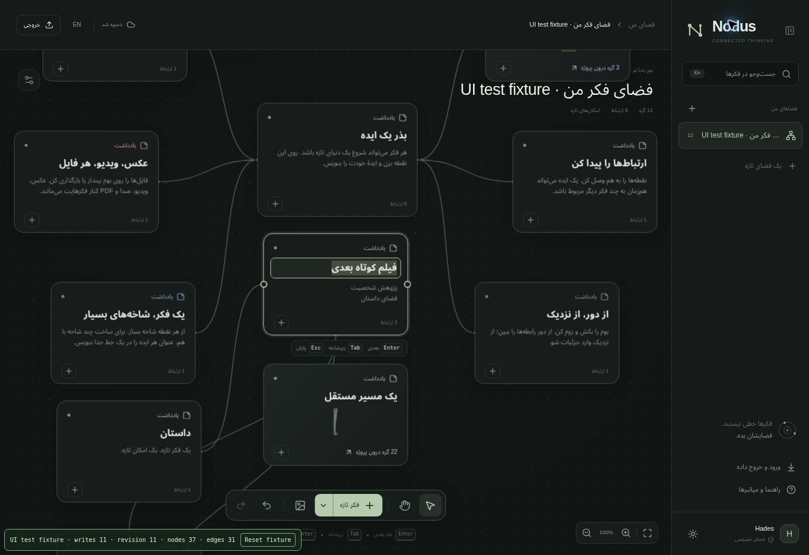

# Nodus

Nodus is a personal brainstorming application built around connected thoughts and nested projects. A node can contain a note, an uploaded file, a link, or its own board. Opening a project changes the working canvas without losing its place in the parent graph.

The application has a React interface, a server API, a persistent SQL database and original-file storage. The initial board is editable guidance, with a real nested project and no pretend uploads.

## Working with a board

- Select a node to keep thinking on the canvas. Open **Details** or press **Shift+Enter** to read its full content and attachments.
- Write titles directly on cards. **Enter** commits a thought and starts its next sibling; **Tab** commits it and starts a connected child. Focus follows the new card without a modal or a fit-to-canvas jump.
- Drag a node to move it. Drag the background to pan, and use the zoom controls, wheel or touch pinch to change scale.
- Connect existing nodes, or create multiple connected branches from a list of titles.
- Open a node's internal project to work on its own board; the breadcrumb trail leads back out.
- Drop files onto the canvas or use the upload action. Images, supported video/audio formats and PDFs have previews; other formats retain their original download.
- Use undo and redo for document changes. The editor keeps up to 60 in-session undo snapshots.
- The interface supports Persian and English. Content can contain either language independently of the interface language.

Graph connections and containment are different relationships. Connections may form cycles. A project cannot contain itself, directly or indirectly.

### Keep thinking with the keyboard

The following shortcuts apply while the canvas or a thought card has focus. Ordinary fields, dialogs, link controls, and the notes textarea keep their normal keyboard behavior.

| Key | Action |
| --- | --- |
| Enter | Start a thought, or commit the current title and start a sibling. |
| Tab | Start a connected child of the current thought. |
| Shift+Tab | Finish the title and return to its graph parent; without a parent, normal backward focus remains available on a card. |
| Arrow keys | Move to a card in that physical direction. From the empty canvas selection, enter at the closest thought. |
| F2 / double-click a note | Edit its title in place. Typing on a focused card also starts a replacement title. |
| Shift+Enter | Finish the title and open notes and details. |
| Ctrl / Cmd+Enter | Open the focused card's nested project. |
| Escape | Finish inline writing, or discard an empty new draft. On a card, clear selection and focus the canvas; Tab can then leave the canvas. |
| N / F | New independent thought / fit the canvas, outside text fields. |
| Ctrl / Cmd+Z | Undo a committed graph change. Text fields retain native text undo. |

Enter on a root thought creates another independent root. A sibling shares the source's first valid incoming connection; this does not turn an arbitrary graph into a strict tree. Children start on the left in Persian and on the right in English. Placement avoids existing cards without moving earlier thoughts.

An empty new card is only a view draft: repeated Enter or Tab does not save empty notes. Its title and connection enter undo history together when committed. Persian text, input-method composition, paste, and native text shortcuts are handled within the inline editor.

Starting a title from a zoomed-out overview raises the scale to 100%, bounded by the available width of the card. Subsequent Enter and Tab keep that scale and pan only as needed. Reveal margins keep the active card above the floating toolbar.

## Saving, recovery and limits

The server is the durable source of truth. Browser storage holds view preferences and a recovery draft for pending changes. “Saved” is shown only after the server acknowledges a write.

Inline typing stays local to its input rather than serializing the entire workspace per character. Enter, Tab, blur, navigation and page-departure handlers commit the current title into the ordinary recovery/save queue. “Writing…” distinguishes an active unsaved title from a server-acknowledged save. Recovery storage is still written synchronously for every committed graph change.

If a title cannot be committed, its text remains editable. The `beforeunload` guard requests the browser's departure confirmation so a failed title commit is not silently treated as saved.

Writes include the document revision. When another tab has saved newer content, the server rejects a stale write instead of overwriting it. Recovery can preserve the local graph as separate root boards. Keep the page open if saving fails and the browser reports that its recovery storage is unavailable.

Current limits are:

| Item | Limit |
| --- | --- |
| Individual uploaded file | 25 MiB |
| Workspace save request | 5 MiB of JSON |
| Boards per workspace | 2,000 |
| Nodes per workspace | 5,000 |
| Connections per workspace | 20,000 |
| Text in one node | 100,000 characters |

The canvas can be panned freely; these record limits still apply. Browser codec support determines whether a particular video or audio file can play inline. Unknown file formats, HTML and SVG are served as downloads. Removing a node does not delete its original uploaded file, so undo and recovery retain access to attachments.

A JSON export contains the graph, text, relationships and attachment references. **It does not include binary attachments and is not a complete portable file backup.** Attachment references remain tied to the owning account on the same deployment. Download important originals separately.

## Scope of this version

Nodus does not currently call an AI model, automatically infer branches, transcribe media, extract PDF text or provide simultaneous multiplayer editing. Branches are authored by the user, either individually or by splitting the lines of an existing note. Revision conflict handling protects edits across tabs; it is not a real-time collaboration engine. First load requires access to the authenticated server; local draft recovery is not a complete offline mode.

## Technology

| Layer | Implementation |
| --- | --- |
| Interface | React, TypeScript, custom DOM/SVG canvas |
| Application runtime | Vinext and a Cloudflare Worker |
| Graph records | Cloudflare D1, with versioned Drizzle migrations |
| Original files | Cloudflare R2 |
| Authentication | Sites-managed ChatGPT sign-in |
| Local recovery | Account-scoped browser local storage |

See [docs/ARCHITECTURE.md](docs/ARCHITECTURE.md) for the data model, API, persistence behavior and extension points.

## Run locally

Use a current Node 24 installation for the application and bundled native TypeScript/SQLite tests. The starter's application engine requirement is Node 22.13 or later. A clean checkout selects the portable execution profile automatically.

Install the locked dependencies and build the Worker:

```sh
npm ci
npm run build
```

For a fresh local database, apply the checked-in initial migration once:

```sh
node --import ./scripts/sites-env.mjs ./node_modules/wrangler/bin/wrangler.js d1 execute DB --local --config dist/server/wrangler.json --persist-to .wrangler/state --file drizzle/0000_nebulous_champions.sql
```

Start the development server:

```sh
npm run dev
```

Use the URL printed by the server. The portable development profile offers simulated sign-in at `/signin-with-chatgpt?return_to=/` on loopback only. That simulation is disabled in the managed profile and is not included in production. The production API has no anonymous or shared-user fallback.

To inspect the built Worker locally after building:

```sh
npm start
```

The built preview shares `.wrangler/state` with development and migration commands. It does not deploy or simulate sign-in.

### Schema changes

After editing `db/schema.ts`, generate a new migration:

```sh
npm run db:generate
```

Inspect and commit the generated SQL and Drizzle metadata. Build again if bindings changed, then apply only each new pending SQL migration to the local database using the command above with its filename. Do not replay an applied migration or rewrite its history. Hosted deployment applies migrations separately from local preview.

### Tests

Run the graph, keyboard-flow, recovery and backend suites:

```sh
node --import ./tests/server-loader.mjs --test tests/graph.test.ts tests/flow.test.ts tests/workspace-store.test.ts tests/server.test.mjs
```

The latest completed run passed all **45 tests**. The backend suite uses an in-memory SQLite database initialized from the checked-in migrations. It exercises actual conditional save statements, account isolation, attachment ownership, graph validation and media byte ranges.

### Browser verification

The development server exposes [tests/browser/flow-fixture.html](tests/browser/flow-fixture.html) and the [390 × 844 mobile frame](tests/browser/flow-mobile.html). Vinext may remove `.html` from the displayed URL. The fixture mounts the real interface with a clearly labelled synthetic workspace and a page-local workspace API. Its fake server validates revisions and persists in session storage across refreshes; attachment API calls are blocked. These files are development fixtures outside production entrypoints. Production authentication is unchanged.

The completed browser checks verified:

| Interaction | Observed result |
| --- | --- |
| Persian Enter, Tab and Shift+Tab | Sibling creation, child creation and return to the parent work in sequence. |
| Twenty sibling branches | A parent and 20 children produce 21 nodes and 20 edges, preserved after reload. |
| Empty drafts and history | Empty cards are not saved; undo and redo treat each new node and its connection atomically. |
| Notes and project navigation | Notes retain native multiline editing; Ctrl+Enter opens the nested board. Returning to the parent board commits the current inline title. |
| Focus transitions | Escape followed by Tab leaves the canvas. Clicking the language control commits the current title and leaves focus on that control. |
| Mobile frame | Title editing and branch creation work at 390 × 844, with readable cards clear of the toolbar. |
| Pointer controls | Dragging changes the saved node position; canvas panning and zoom controls remain available. |

These are browser checks against synthetic persistence, not a deployed authenticated UI test. Physical touch devices, native IME sessions and production signed-in behavior were not verified in this pass.



## Hosting

The tracked `.openai/hosting.json` declares `DB` and `BUCKET` and identifies this Sites project. Hosting uses the Sites source, version and publication workflow. Preserve the project identity when updating this deployment. A different deployment must provision its own bindings and trusted authentication boundary.

Do not expose the Worker directly while trusting arbitrary client-supplied identity headers. Production authentication is provided by the Sites gateway, which supplies the authenticated visitor headers. Secrets, local runtime state, dependency folders, generated builds and publication archives are excluded from source control.
