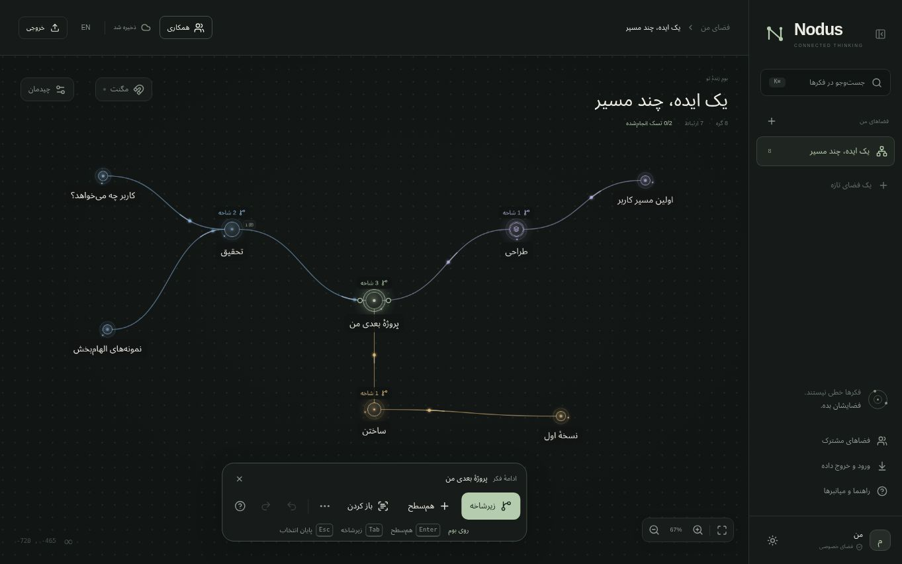
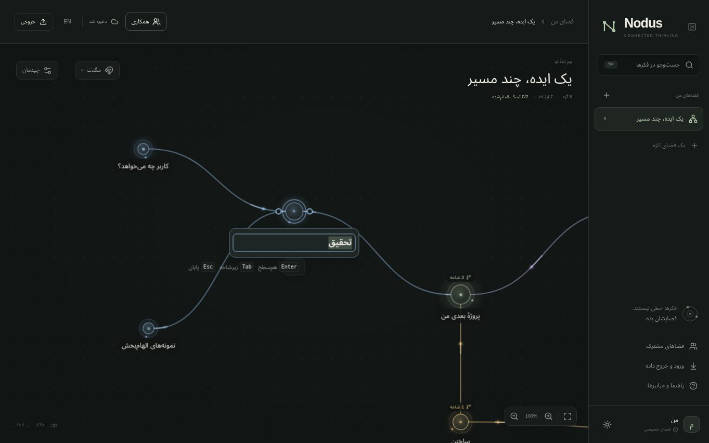
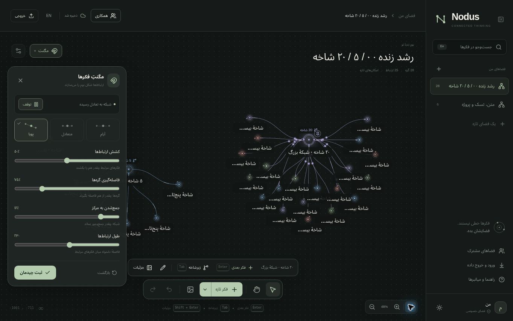
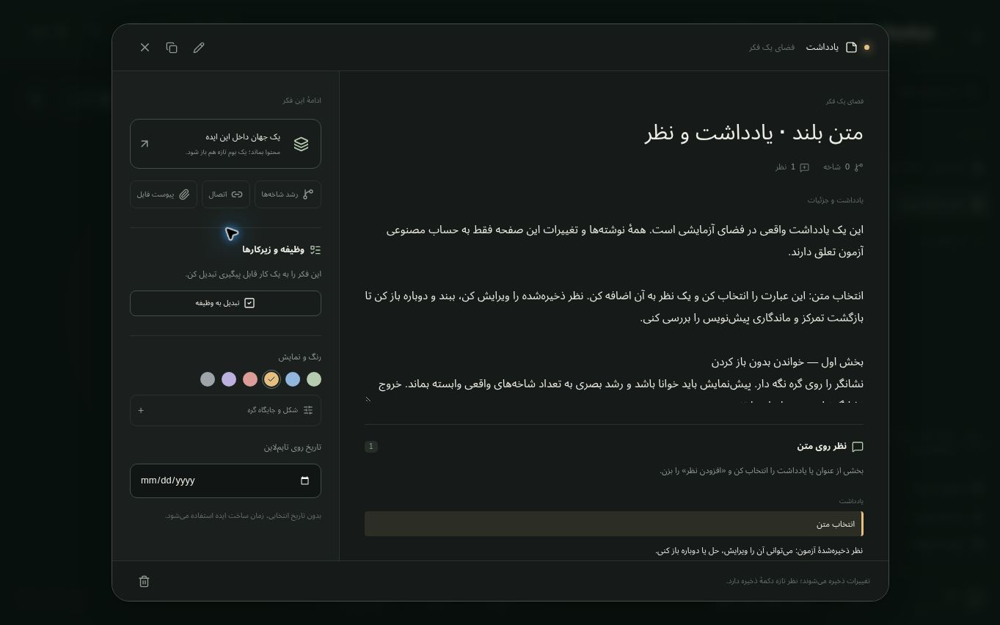
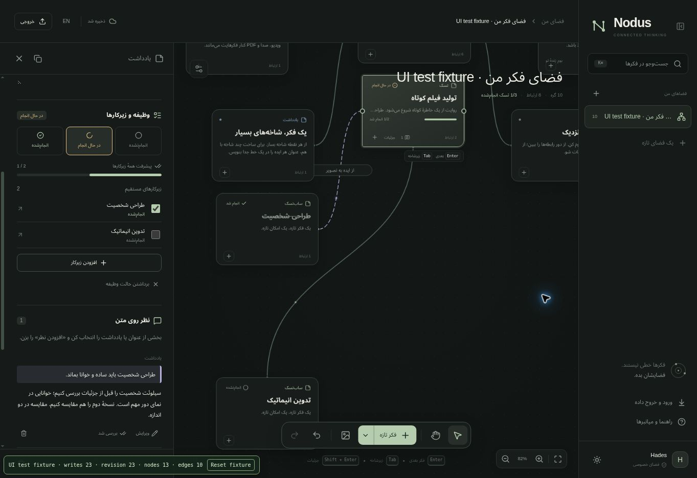
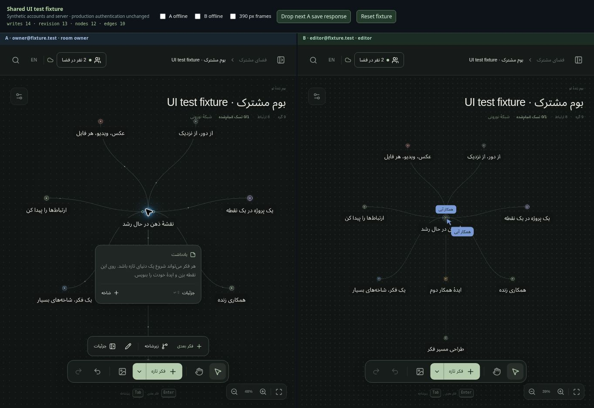
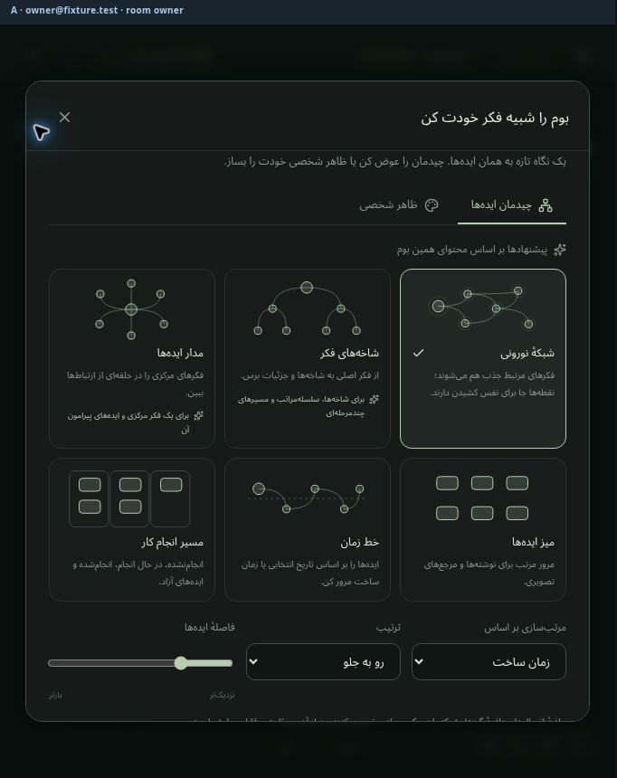

# Nodus

Nodus is a brainstorming application for personal and shared work, built around connected thoughts and nested projects. A node can contain a note, an uploaded file, a link, or its own board. Opening a project changes the working canvas without losing its place in the parent graph.

The application has a React interface, a server API, a persistent SQL database and original-file storage. The initial board is editable guidance, with a real nested project and no pretend uploads.

## Development roadmap

The [living roadmap](docs/ROADMAP.md) prioritizes usability, capabilities, visual design, personalization and animation, with acceptance criteria for each item. The [development loop](docs/DEVELOPMENT_LOOP.md) defines hourly work, isolated branches for special/large changes, verification, publication and source synchronization. The [development log](docs/DEVELOPMENT_LOG.md) records actual outcomes and the next checkpoint. The roadmap is updated whenever a capability becomes available; a feature being coded or verified is not yet a released feature.

## Working with a board

- Hover over a node for a readable content preview. Click it to open its full content and attachments in a popup; **Shift+Enter** opens the notes editor directly.
- Write titles directly beside neurons or on cards. **Enter** commits a thought and starts its next sibling; **Tab** commits it and starts a connected child. Focus follows the new thought without a modal or a fit-to-canvas jump.
- Drag a node to move it. Drag the background to pan, and use the zoom controls, wheel or touch pinch to change scale.
- Open **Magnetic mode**, then press **Start** or choose a preset to let linked thoughts pull together. The four force sliders are available under **Fine-tune forces and spacing**; merely opening the panel does not move the graph. **Apply layout** commits the resulting arrangement as one undoable change.
- Connect existing nodes, or create multiple connected branches from a list of titles.
- Open a node's internal project to work on its own board; the breadcrumb trail leads back out.
- **Search** (Ctrl/Cmd+K) checks all nested boards. Results show the complete project path and true total; use **Previous/Next** for bounded pages of 70 instead of loading thousands of result buttons at once. On the in-progress branch, **Enter** in the Search input opens the first result of the current page; Persian IME confirmation is not a navigation command, and changing the query resets the result list to the top. (ND-001 is not yet on the live site.)
- Drop files onto the canvas or use the upload action. Images, supported video/audio formats and PDFs have previews; other formats retain their original download.
- Use undo and redo for document changes. Personal workspaces retain up to 60 in-session snapshots; shared rooms retain guarded operations belonging to this session so undo cannot replace a colleague's newer work.
- The interface supports Persian and English. Content can contain either language independently of the interface language.

Graph connections and containment are different relationships. Connections may form cycles. A project cannot contain itself, directly or indirectly.

### Keep thinking with the keyboard

The following shortcuts apply while the canvas or a thought card has focus. Ordinary fields, dialogs, buttons, link controls, and the notes textarea keep their normal keyboard behavior. Focus must be on the graph itself: a selection does not activate graph commands while a sidebar or toolbar control has focus.

| Key | Action |
| --- | --- |
| Enter | Start a thought, or commit the current title and start a sibling. |
| Tab | Start a connected child of the current thought. |
| Shift+Tab | Finish the title and return to its graph parent; without a parent, normal backward focus remains available on a card. |
| Arrow keys | Move to a card in that physical direction. From the empty canvas selection, enter at the closest thought. |
| F2 | Edit the focused node's title in place. Letter keys never silently replace an existing title. |
| Shift+Enter | Finish the title and open notes and details. |
| Ctrl / Cmd+Enter | Open the focused card's nested project. |
| Escape | Finish inline writing, or discard an empty new draft. On the graph, clear selection and end multi-select mode; Tab can then leave the canvas. A focused open panel closes locally first. |
| N / T / F | New independent thought / new task / fit the canvas, outside text fields. |
| Delete / Backspace | Remove the selected thoughts or focused connection; graph undo restores them. On an edge's bend handle, reset the path. |
| Ctrl / Cmd+Delete | Remove the selected thoughts or focused connection. Text fields retain their native deletion shortcuts. |
| Shift+F10 | Open the context menu for the focused node, connection or canvas. |
| Ctrl / Cmd+Z | Undo a committed graph change. Text fields retain native text undo. |
| Ctrl / Cmd+A | Select every thought on the active board while a graph surface has focus. Text fields retain native Select All. |
| Ctrl / Cmd+K | Search while a graph surface has focus. The sidebar Search button is always available. |
| Space | Open a focused thought; temporarily pan when the canvas itself has focus. Native buttons still activate normally. |

Enter on a root thought creates another independent root. A sibling shares the source's first valid incoming connection; this does not turn an arbitrary graph into a strict tree. Children start on the left in Persian and on the right in English. Placement accounts for growth-expanded cards, including the parent after its new branch, without moving earlier thoughts.

An empty new card is only a view draft: repeated Enter or Tab does not save empty notes. Its title and connection enter undo history together when committed. Persian text, input-method composition, paste, and native text shortcuts are handled within the inline editor.

Starting a title from a zoomed-out overview raises the scale to 100%, bounded by the available width of the card. Subsequent Enter and Tab keep that scale and pan only as needed. Reveal margins keep the active card above the floating toolbar.

### A quieter canvas

A single contextual dock replaces the stacked creation toolbar, selection toolbar and repeated shortcut footer. With no selection, **New thought** is the primary action. With one selected thought, **Branch**, **Sibling** and **Open** continue it; **More actions** holds title editing, other content types, uploads and pan/selection tools. Selecting several thoughts replaces these actions with a compact group toolbar showing the count, color, task state, Delete and Undo/Redo. The hint row advertises graph shortcuts only when the canvas or a thought actually has keyboard focus. While writing a title, the dock disappears and Enter/Tab/Escape instructions stay beside the input. **Shortcut guide** separates canvas actions, inline title flow and ordinary text/dialog behavior, with advanced commands collapsed by default.

The selected thought's small color-and-status control opens a palette of **Sage, Blue, Amber, Rose, Violet and Gray**, together with **Idea, To do, In progress and Done**. Changes appear on the real node immediately. The panel keeps ordinary button and Tab behavior; Escape closes only the panel and returns focus to its trigger. Clicking outside or selecting another thought dismisses it. Read-only workspaces can inspect these choices but cannot change them.

### Work with several thoughts

**Shift+click** toggles a thought in the selection. **Shift+drag on empty canvas** draws a selection rectangle and adds the intersecting thoughts to the current group. Ordinary background dragging still pans. For tapping or selection without holding a key, choose **More actions → Select multiple thoughts**: tapping thoughts toggles them, and dragging a rectangle replaces the selection; hold Shift while drawing to add instead. **Ctrl/Cmd+A** selects the active board only when the graph has focus. **Escape** on the graph or the toolbar's clear-selection button ends the group selection.

Drag any selected thought to move the group together, retaining its relative positions. The preview stays local while dragging; release commits all positions as one undoable change. If a selected node was moved or removed meanwhile, the guarded update rejects the whole movement rather than applying only part of it. A click on a member of an existing group keeps the group selected.

The group toolbar shows **Mixed colors** or **Mixed status** when the selected thoughts differ. Choosing a color or task state applies it to the entire selection in one undo step. Choosing **Idea** removes task status while preserving surviving subtasks. **Delete** removes the selected thoughts and their contained projects; confirmation appears when additional nested project content would be removed. Ordinary connected neighbors survive. One Undo restores the complete group edit or deletion.

Selection is temporary local state for the current account, space and board. Selecting thoughts, drawing a rectangle and opening the toolbar do not create document saves. Magnetic movement pauses during group selection or explicit multi-select mode so the targets stay still; node and connection lighting remains live, subject to the existing motion preferences. Toolbar buttons and popovers retain native keyboard behavior.

### Tasks, comments and connection editing

Choose **New task** in the add menu, press **T** with the canvas focused, use **Make a task** in a card's context menu, or select a task state in the dock's color-and-status panel. Any content node can also be a task. Tasks have **To do**, **In progress** and **Done** states. Choosing a state for an idea creates its task metadata and sets the requested state in one undoable change; **Idea** removes task status. **Tab** on a task creates a subtask; **Enter** creates another task with the same task parent. Neurons show a persistent status word and icon below the title, plus a completed/total subtask counter when applicable; dense overview zoom reduces the label to its icon. Cards and Details also show completion controls and progress. Status remains identifiable independently of the node's chosen color. Task ancestry is separate from ordinary graph connections, so changing an edge does not silently move a task to another parent. Removing a parent's task status or deleting it promotes its surviving direct subtasks to root tasks, retaining their content, status and descendants.

In Details, select a phrase in the title or notes and add an **annotation**. Comments retain the exact quote, can be edited, colored, resolved, reopened or deleted, and have an explicit save action. Unsaved comment drafts are scoped to the account, room and node. Editing surrounding text adjusts an unambiguous annotation anchor. A removed or changed quote keeps its comment and is marked as detached, rather than attaching the comment to unrelated text.

Right-click a card, connection or empty part of the canvas for relevant actions. **Shift+F10** or the keyboard context-menu key opens the same menu. Native text-field menus remain available. **Delete**, **Backspace** and **Ctrl/Cmd+Delete** remove selected thoughts or a focused connection; deleting contained project content asks for confirmation. Undo restores removed graph content. In text fields these keys continue to edit text.

Select a connection to change its label, endpoints, direction, color, width, solid/dashed/dotted stroke and curved/straight/elbow route. Drag its middle handle to reshape the path, or nudge the focused handle with arrow keys. Resetting the handle restores the automatic route. Nodes have card, sticky-note and outline appearances, plus editable canvas coordinates.

Visible nodes breathe subtly and light travels along connections in both neuron and card views, including overview zoom. More connected work produces a stronger glow, faster breathing and faster orbits, with smooth limits on intensity and speed. Incoming and outgoing connections both contribute. Every eligible visible connection has directional flow, with a bounded set of bright moving particles; signal speed follows the endpoint with the greater visual weight. Light takes the source node's color unless the connection has its own color. Motion pauses when the page is hidden, and reduced-motion preferences use a static presentation. Animation can also be disabled per connection. These effects and hover previews do not change the document or create saves.

### Neural views, layout and personal appearance

Open **Canvas layout and style**, beside the board heading. The default view uses luminous neuron cores with readable titles. Nodes grow with their unique connected neighbors in either direction, including explicit task-parent relationships, plus reachable descendants and contained project content. A receiving hub grows just as a sending hub does. Reciprocal edges and a graph connection that repeats a task relationship count the same neighbor once; note length does not affect size. Cycles and converging branches count each reachable node once. **Content cards** retain a more restrained version of the same growth, without changing stored node dimensions.

Hover previews remain readable when the board is zoomed out. A click opens the real node in a full content popup; **F2** keeps title editing on the canvas. Opening an internal project still changes the working board rather than expanding all its descendants into the parent canvas.

| Layout | What it does |
| --- | --- |
| Neural network | Uses connection attraction, node repulsion and collision spacing to settle related thoughts into a network. |
| Thought tree | Places connected generations in columns, including disconnected components and cyclic graphs. |
| Idea orbits | Places the most connected idea in the center and arranges other ideas on surrounding rings. |
| Idea grid | Uses consistent rows and columns for scanning content and references. |
| Timeline | Groups ideas by the date selected in Details, falling back to creation date. |
| Task lanes | Arranges To do, In progress, Done and ideas without a task status in separate lanes. |

Suggestions use the actual board's links, task hierarchy, content kinds and dates. They are deterministic recommendations, not generated AI content. Ordering controls include creation date, title, content type, color and task status, with ascending/descending order and adjustable spacing. Timeline dates and task lanes take priority over sorting; the selected sort orders ideas within those groups.

Layouts apply to the current board as one undoable change. They use the same growth-expanded card bounds as keyboard placement to avoid collisions, retain content, containment and relationships, and reset manually bent paths on that board. The layout description and lane orientation are saved with the board so collaborators see the same arrangement and language changes do not swap lane meanings. Applying a layout is an explicit action: after changing task states, dates or adding ideas, apply it again to regroup them. Growth does not automatically move existing nodes. Dragging a node does not change its task state or date.

The one-time **Neural network** layout runs for a bounded number of iterations, then stops. Boards above 250 nodes use connected clusters instead of its all-pairs calculation. The separate **Magnetic mode** provides interactive force-driven movement. Decorative light remains independent of both arrangements.

Personal appearance includes neuron/card presentation, dots/grid/plain background, three density settings, six accent colors and optional connection labels. These settings are scoped to account, room and board on the current device; each collaborator can choose their own presentation while sharing the same graph and positions. Reduced motion remains respected.

### Magnetic mode

Use the magnet button on the canvas to open **Thought magnets**. Linked nodes attract each other, nearby nodes repel each other, and a center force keeps the network together. The **Gentle**, **Balanced** and **Organic** presets provide starting points; four sliders control link attraction, node repulsion, center gravity and preferred link distance.

Busy hubs distribute their spring pull across connected neighbors and allow more room around larger branches. Collision correction separates overlapping nodes without turning the correction into a bouncing impulse. Adding a branch or changing a node's projected size keeps existing motion continuous within the same board view; newly added or externally moved nodes begin at rest.

**Start / Pause** controls movement, **Rebalance** wakes a settled network, and the node context menu can **Pin / Unpin** a thought. A pinned node remains a force anchor while its neighbors can move; dragging still lets you place it deliberately. Closing the settings panel leaves the selected mode active. Movement pauses automatically while reading a hover preview, writing inline, using a content popup or context menu, editing a connection, or selecting a group. Hidden pages and reduced-motion preferences also stop the simulation.

Force-driven positions and pins belong to the personal view. They are cached locally for the current account, personal/shared context and board, and restored only when their saved base coordinates still match the current graph. **Pause** keeps that view. **Restore** discards its displacement and pins and returns to the current document positions. An ordinary manual drag remains a document edit.

Choose **Apply layout** to save the visible magnetic positions to the board. The application checks the expected base coordinates before accepting the whole arrangement, preserves node content and relationships, clears the previous structured-layout guides, and records one undo step. A conflicting moved or deleted node rejects the application instead of replacing a newer position. Read-only rooms cannot apply positions. Once applied, use ordinary Undo to reverse the document change.

The simulation cools and sleeps when settled or after eight seconds of simulation time per burst. Larger boards use a lower update cadence, and repulsion/collision work uses bounded spatial traversal. Typing, changing a color or changing a task's completion state does not restart the force graph. No simulation frame creates a graph save; keyboard placement and directional navigation use the displayed positions so Enter and Tab continue from the visible thought.

### Delete a personal space

Use the delete button beside a root space in **My Spaces**. The confirmation names the space and shows its total node count and nested-project count. Confirming removes that root, its contained canvases and their nodes/connections as one undoable document change. Other personal spaces keep their content and relationships. This action is unavailable in shared rooms and does not delete a shared room.

Deleting the home space chooses another surviving root as home. If you are viewing any canvas inside the deleted space, navigation returns to the resulting home. Deleting the last personal space creates one fresh blank space with no sample thoughts. Uploaded files are not deleted from R2, and one Undo restores the removed graph and attachment references. Undo depends on the current session's history; there is no persistent trash or deleted-space archive after that history is gone.

### Working together

1. Open **Collaborate and share** on a personal board and choose **Create shared copy**. Only the current board and its contained boards are copied; unrelated personal boards are excluded.
2. Add the other person's **ChatGPT sign-in email**. This grants editing access to that shared room. The app does not send an invitation email.
3. Copy the room link and open it from both accounts. Each person must also have access to the hosted Site; room membership cannot bypass the Site's private audience policy.

The owner can add and remove members. A copied link alone grants no access. Existing personal content remains available through the room switcher, and creating a shared copy does not keep it linked to the original personal board.

Shared edits are persisted on the server. Changes to different fields can merge, including updates from a temporarily disconnected client. When two people change the same field, the editor preserves the local draft and shows a conflict instead of silently overwriting someone else's work. Recovery can retain the local version as separate boards. Text edits are guarded as complete fields, and annotations are guarded as an array; simultaneous character-by-character coauthoring of one note is not implemented.

Cursors, names and selected-node indicators appear on the same board. Each person can pan, zoom or change their personal presentation independently. Presence expires after 15 seconds without a heartbeat. Document polling starts around one second and backs off when idle; moving cursor updates are throttled to 500 ms, with independent presence reads. Network latency adds to these intervals. Hidden pages pause polling. This implementation uses authenticated HTTP synchronization, not WebSocket streaming.

Uploads remain private unless referenced by a room the viewer currently belongs to. Removing the room reference or a member revokes that shared-file access; the uploader retains access to their own original file. The current room limit is 20 members.

## Saving, recovery and limits

The server is the durable source of truth. Browser storage holds view preferences and a recovery draft for pending changes. “Saved” is shown only after the server acknowledges a write.

Inline typing stays local to its input rather than serializing the entire workspace per character. Enter, Tab, blur, navigation and page-departure handlers commit the current title into the ordinary recovery/save queue. “Writing…” distinguishes an active unsaved title from a server-acknowledged save. Recovery storage is still written synchronously for every committed graph change.

If a title cannot be committed, its text remains editable. The `beforeunload` guard requests the browser's departure confirmation so a failed title commit is not silently treated as saved.

The content popup opens from its source node with a brief shell expansion, staged content reveal and rim light, then returns toward the captured origin when dismissed. An unavailable or offscreen source uses a centered transition; reduced-motion preferences remove the movement. Keyboard focus stays inside throughout opening and closing, and returns to the node after dismissal. URL and position drafts are validated and committed before closing begins or before leaving for another action; a rejected edit keeps the popup and draft open. Content cannot be edited during its short closing transition. Escape can cancel a dirty field before closing the popup. Annotation drafts retain their explicit Save action and scoped recovery when the popup closes. Native text editing and input-method composition keep their own key handling.

Magnetic settings, pins and unapplied positions are local view preferences, not a server backup or a shared revision. Losing browser storage loses that personal view; the canonical graph is unchanged until an ordinary graph edit or **Apply layout** is accepted. Cache restoration discards entries whose node, board or base position no longer matches.

Personal writes include the document revision. When another tab has saved newer personal content, the server rejects a stale write instead of overwriting it. Shared rooms send guarded field operations and merge compatible edits against the current revision. Retry receipts prevent a lost save acknowledgement from applying a shared edit twice. Recovery can preserve the local graph as separate root boards. Keep the page open if saving fails and the browser reports that its recovery storage is unavailable.

Shared recovery drafts use per-tab session storage, scoped to account and room. They survive a refresh in that tab but are not a durable backup after closing it. Revoked access freezes shared writes and retains pending work for export. Remote document application pauses during inline writing or unsaved popup drafts, including URL, position and annotation edits, so the visible editing base remains protected even when an earlier save response arrives.

Current limits are:

| Item | Limit |
| --- | --- |
| Individual uploaded file | 25 MiB |
| Persisted graph, personal or shared | 1,900,000 UTF-8 JSON bytes; media is stored separately |
| Personal/create transport body | 5 MiB |
| Shared operation transport body | 12 MiB, including before/after guards |
| Boards per workspace | 2,000 |
| Nodes per workspace | 5,000 |
| Connections per workspace | 20,000 |
| Text in one node | 100,000 characters |

The canvas can be panned freely; these record limits still apply. Browser codec support determines whether a particular video or audio file can play inline. Unknown file formats, HTML and SVG are served as downloads. Removing a node does not delete its original uploaded file, so undo and recovery retain access to attachments.

The serialized graph cap leaves headroom below D1's [2,000,000-byte row limit](https://developers.cloudflare.com/d1/platform/limits/). The count limits and byte limit apply together; large notes or metadata can reach the byte limit before the maximum node count. Existing stored graphs remain readable even if a future write exceeds the cap.

A JSON export contains the graph, text, relationships and attachment references. **It does not include binary attachments and is not a complete portable file backup.** Original attachments remain on the same deployment and require current ownership or room access. Download important originals separately.

## Scope of this version

Nodus does not currently call an AI model, automatically infer branches, transcribe media or extract PDF text. Branches are authored by the user, either individually or by splitting the lines of an existing note. Shared graph editing and live presence are implemented; same-field conflicts require recovery rather than character-level merging. First load requires access to the authenticated server; local draft recovery is not a complete offline mode.

## Technology

| Layer | Implementation |
| --- | --- |
| Interface | React, TypeScript, custom DOM/SVG canvas |
| Application runtime | Vinext and a Cloudflare Worker |
| Graph records | Cloudflare D1, with versioned Drizzle migrations |
| Original files | Cloudflare R2 |
| Authentication | Sites-managed ChatGPT sign-in |
| Shared synchronization | Guarded field operations, transactional D1 receipts and throttled presence |
| Local recovery | Account-scoped local storage for personal work; account-and-room-scoped session storage for shared drafts |

See [docs/ARCHITECTURE.md](docs/ARCHITECTURE.md) for the data model, API, persistence behavior and extension points.

## Run locally

Use a current Node 24 installation for the application and bundled native TypeScript/SQLite tests. The starter's application engine requirement is Node 22.13 or later. A clean checkout selects the portable execution profile automatically.

Install the locked dependencies and build the Worker:

```sh
npm ci
npm run build
```

For a fresh local database, apply the checked-in migrations once, in order:

```sh
node --import ./scripts/sites-env.mjs ./node_modules/wrangler/bin/wrangler.js d1 execute DB --local --config dist/server/wrangler.json --persist-to .wrangler/state --file drizzle/0000_nebulous_champions.sql
node --import ./scripts/sites-env.mjs ./node_modules/wrangler/bin/wrangler.js d1 execute DB --local --config dist/server/wrangler.json --persist-to .wrangler/state --file drizzle/0001_spooky_medusa.sql
```

Start the development server:

```sh
npm run dev
```

Use the URL printed by the server. The portable development profile offers simulated sign-in at `/signin-with-chatgpt?return_to=/` on loopback only. That simulation is disabled in the managed profile and is not included in production. The production API has no anonymous or shared-user fallback.

To inspect the built Worker locally after building:

```sh
npm start
```

The built preview shares `.wrangler/state` with development and migration commands. It does not deploy or simulate sign-in.

### Schema changes

After editing `db/schema.ts`, generate a new migration:

```sh
npm run db:generate
```

Inspect and commit the generated SQL and Drizzle metadata. Build again if bindings changed, then apply only each new pending SQL migration to the local database using the command above with its filename. Do not replay an applied migration or rewrite its history. Hosted deployment applies migrations separately from local preview.

### Tests

Run the graph, layouts, keyboard-flow, collaboration, recovery and backend suites:

```sh
node --import ./tests/server-loader.mjs --test tests/*.test.ts tests/*.test.mjs
```

The current multi-selection and personal-space release recorded **205 automated tests passing**. New coverage includes projected rectangle selection, add/toggle/replace semantics, board-scoped bulk updates/deletion, task ancestry, large/deep containment and personal-space deletion with an actual single Undo/Redo snapshot. Its separate [browser-verification record](docs/SELECTION-SPACES-QA.md) documents the completed group interaction, deletion/recovery and mobile-frame checks and their coverage limits.

The earlier clarity release recorded **165 automated tests passing** with TypeScript checking passing; the preceding magnetic and living-node releases recorded 157 and 130 tests respectively. These are historical verification snapshots. The current suite covers graph and task hierarchy, incoming/outgoing connection growth, growth-aware layout and keyboard placement, magnetic simulation and guarded layout application, annotation anchors, connection geometry, recovery, collaboration and persistence. The backend tests use an in-memory SQLite database initialized from the checked-in migrations. They exercise actual conditional save statements and transactions, independent identities, field conflicts, receipt retries, revocation during commit, rollback, attachment access, graph validation and media byte ranges. Client tests cover pause/resume races, lost acknowledgements, guarded own undo, room/account scoping and presence lifecycle.

The connectivity update extends `tests/node-growth.test.ts` with incoming hubs, reciprocal/task-link deduplication and delete/restore behavior. `tests/node-energy.test.ts` checks monotonic, bounded light and motion values. `tests/magnetic-layout.test.ts` adds 20/50-branch and one-sided hubs, mixed node sizes, held-node collision behavior, 60/30/20-step consistency and retained motion across topology changes. These deterministic tests use synthetic graphs; the UI fixtures below exercise the real application against isolated synthetic persistence.

`tests/node-selection.test.ts` covers partially intersecting projected nodes, invalid geometry, stable selection merging, mixed task/color updates, no-op identity, atomic validation, contained-project deletion, surviving task descendants and 5,000-node batches. `tests/personal-spaces.test.ts` covers home/non-home/last-root deletion, nested and foreign target rejection, preservation of other roots and files, defensive reference cleanup, graph validation, one-step store history and a 2,000-board chain.

### Browser verification

See the [multi-selection and personal-space verification record](docs/SELECTION-SPACES-QA.md) for measured group gestures, bulk controls, deletion/Undo, reload, ordinary pan and mobile layout on the isolated real application.

The connected-growth release passed **181 automated tests** and TypeScript checking. Its managed-browser checks verified incoming hub growth, variable animation periods, color/status persistence and Undo/Redo, native panel keyboard behavior, mobile fit, magnetic settling, exact pins and drag response. See the [connected-growth verification record and screenshots](docs/CONNECTED-GROWTH-QA.md) for measurements and coverage boundaries.

The development server exposes [tests/browser/flow-fixture.html](tests/browser/flow-fixture.html) and the [390 × 844 mobile frame](tests/browser/flow-mobile.html). Vinext may remove `.html` from the displayed URL. The fixture mounts the real interface with a clearly labelled synthetic workspace and a page-local workspace API. Its fake server validates revisions and persists in session storage across refreshes; attachment API calls are blocked. These files are development fixtures outside production entrypoints. Production authentication is unchanged.

[tests/browser/shared-fixture.html](tests/browser/shared-fixture.html) adds two instances of the real app under separate synthetic identities. Both use one fixture-only canonical room, actual guarded diff/apply and graph validation, presence, membership and idempotent receipts. Controls simulate each peer going offline and a lost acknowledgement. The fixture never grants access to production data or bypasses production authentication.

[tests/browser/living-fixture.html](tests/browser/living-fixture.html) adds a deterministic 37-node, 30-edge, three-board scene with identifiable 0/5/20-branch nodes, long Persian text, an annotation, task/subtasks and a nested project. It mounts the real app under a separate synthetic identity, shows branch and write metrics, and provides reset and 390 × 844 frame controls. Its isolated workspace API validates saves and persists only fixture state in session storage. All other API calls are mocked or blocked, and the scene has no asset references. The existing flow fixture remains unchanged.

[tests/browser/growth-fixture.html](tests/browser/growth-fixture.html), also served at `/tests/browser/growth-fixture`, adds the connected-growth scene. It embeds `/tests/browser/growth-session` using the synthetic `fixture-growth-ui` identity and the `growth-home` board. The scene has 20 nodes and 17 edges: `growth-isolated` has zero connections, `growth-five` has five, and `growth-twelve` has twelve, including ten incoming edges. `growth-task-todo` and `growth-task-done` provide the parent's initial 1/2 completion counter. Their task relationships repeat graph links, so the parent's connection count remains five. Reset and a 390 × 844 frame support repeatable color, status, growth, animation and magnetic checks. Revision-checked saves use the separate `nodus:ui-fixture:growth:server:v1` session-storage key; attachment and shared-room writes are blocked. These routes are DEV-only and do not change production authentication. Their availability describes test infrastructure, not a completed browser verification result.

Earlier completed fixture checks established:

| Interaction | Observed result |
| --- | --- |
| Persian Enter, Tab and Shift+Tab | Sibling creation, child creation and return to the parent work in sequence. |
| Twenty sibling branches | A parent and 20 children produce 21 nodes and 20 edges, preserved after reload. |
| Empty drafts and history | Empty cards are not saved; undo and redo treat each new node and its connection atomically. |
| Notes and project navigation | Notes retain native multiline editing; Ctrl+Enter opens the nested board. Returning to the parent board commits the current inline title. |
| Focus transitions | Escape followed by Tab leaves the canvas. Clicking the language control commits the current title and leaves focus on that control. |
| Mobile frame | Title editing and branch creation work at 390 × 844, with readable cards clear of the toolbar. |
| Pointer controls | Dragging changes the saved node position; canvas panning and zoom controls remain available. |
| Task flow and progress | Enter and Tab create sibling tasks and subtasks; card status cycles and Inspector completion controls update the parent progress. |
| Selected-text annotations | Selected notes and title text accept comments; save, edit, resolve and reopen work. Deleting the source selection preserves the comment as detached; graph undo restores the source and anchor. |
| Annotation recovery | Closing and reopening Details retains a draft. Reloading also restores the unposted draft with its comment and color. |
| Delete and context menus | Node and edge Delete and Ctrl+Delete remove the intended item; undo restores it. Native text Delete edits only the text. Pointer right-click and Shift+F10 expose context actions. |
| Connection editing | Route, stroke, color, width, label and direction changes are rendered. Duplicate endpoints are rejected. Dragging the middle handle and arrow-key nudges reshape the path; Delete on the handle resets it. |
| Persisted feature metadata | Task states, task hierarchy, node appearance, annotations and edge styling survive a fixture reload. |
| Mobile feature panels | At 390 × 844, task conversion and annotation creation worked in the previous Details presentation; the connection editor stayed within the viewport. The full popup is covered in the living-node pass below. |
| Neural keyboard editing | Enter and Tab create connected thoughts in the minimal view; the second session receives their titles and relationships. |
| Shared edits and reconnection | Different fields edited by two synthetic accounts converge. After one session goes offline and rejoins, both local and peer edits remain. Own undo preserves the peer's text. |
| Shared presence | The other session shows the cursor, name and selected node at its own zoom level. Pan/zoom changes remain local. |
| Personal appearance | One session uses spacious content cards with a grid while the other keeps balanced neurons with dots. |
| Timeline and lane metadata | A custom date is saved and creates a separate date group. Both sessions receive the same lane positions; changing interface language translates labels without swapping columns. |
| Member access | Removing the editor in the room panel makes the other session report lost access; adding the email back permits a fresh authorized session. |
| Mobile design and sharing | Both app frames run at 390 × 844. Design and collaboration dialogs stay within the viewport with scrollable contents and no horizontal overflow. |

The previous living-node release browser pass confirmed:

| Interaction | Observed result |
| --- | --- |
| Click and content | A clean node click opens the full dialog with the node's real text. |
| Popup focus | Initial focus is correct, Shift+Tab stays inside the dialog, and closing returns focus to the originating node. |
| Branch metrics | The scene reports the expected 0, 5 and 20 direct branches. |
| Keyboard growth and history | F2 → Tab child → Enter sibling → Escape completes the writing flow. Added branches update growth immediately; Delete and Undo recalculate it. |
| Grown-node dragging | Dragging from the enlarged neuron's center moves the intended node accurately without opening the popup. |
| Long Persian content | The desktop popup renders the complete 1,515-character note without horizontal overflow, with a 29 px title. |
| Annotation drafts | An unposted comment survives closing and reopening the popup, then saves through the explicit Save action. |
| Coordinate validation | A blank X value blocks closing and keeps its draft. A valid X value of 1,200 persists, and the original position can then be restored. |
| Tasks and child details | A checkbox updates progress to 2/3. Opening a subtask's details keeps one modal open. |
| Nested-project growth | From the project popup, entering its board and adding a node updates the parent's nested count to four and recalculates growth. |
| Overview motion and saves | At 45% fit zoom, all 25 visible connections render flow and moving particles. Hover previews and ongoing animation leave the fixture write count at zero. |
| Card-view motion | Switching to cards and applying the neural layout shows six animated card frames, three flow paths and three moving signals. |
| Settled card layout and hover | The six cards have no bounding-rectangle overlaps and their edges attach correctly. Hover enlarges a card and previews its real 1,515-character note. |
| Mobile popup | At 390 × 844, the popup is 362 px wide with no horizontal overflow; its title is 25 px and text is 16 px. Ctrl+End reaches character 1,515, keyboard focus reaches the lower actions/colors/date, and the header close control remains visible and dismisses successfully. |
| Per-edge motion | Disabling one edge's animation through its context controls reduces flow paths and particles from three to two while all six card frames remain animated. Re-enabling restores both counts to three. |

The previous magnetic-release pass used the real app in the same isolated living fixture:

| Interaction | Observed result |
| --- | --- |
| Magnetic controls and settling | Start/Pause and all four force sliders worked. Keyboard adjustment changed distance from 180 to 170 in the RTL interface, and the simulation reached the settled status. |
| Pinning and personal recovery | The pinned 20-branch node kept the same center while other nodes moved. Pause followed by reload restored all 28 projected positions byte-for-byte and retained the pin. |
| Save boundary and undo | Movement produced zero workspace writes before Apply layout. Apply produced one write and cleared the pending-layout state; Undo produced the second write and restored the previous layout. |
| Context menu and pinned dragging | Right-click pinning worked. A native pointer drag moved the pinned center from (706, −114) to (891.94, −312.20), preserving its pin. |
| Hover preview | A native hover check exposed and led to a placement fix. The preview now appears beside its source without covering the source node. |
| Keyboard flow | Tab → child title → Enter → sibling title → Escape created two actual linked nodes. Editing paused magnetic movement, and movement resumed afterward. |
| Popup motion and validation | The dialog used the source-node origin with a 380 ms entrance. X = 20,000,000 kept it open and marked the field invalid; Escape canceled that field draft, and closing returned focus to the source node. |
| Mobile popup and magnetic panel | At 390 × 844, the popup measured 362 × 828 px at (14, 8), with equal client and scroll widths of 360 px. The panel measured 316 × 626 px at (12, 134), its footer stayed inside, and client and scroll widths both measured 314 px. |
| Light appearance | The magnetic panel's accent was darkened for the light theme; the checked layout had no horizontal overflow. |
| Magnetic card layout | The six-node card board settled with zero bounding-rectangle overlaps and no extra workspace writes. |
| Restore | Restore cleared the personal positions, pins and pending-layout state, and paused the mode without saving the workspace. |

Reduced-motion behavior was reviewed in code but was not verified at runtime. The earlier hidden-page check was inconclusive: switching Chrome tabs through desktop automation left the inspected canvas at `data-motion="on"`, so that check did not establish whether hidden-page pausing works; it is not counted as a pass for this release. These are browser checks against synthetic persistence, not a deployed authenticated UI test or a test with two real signed-in users. Physical touch devices, native IME sessions and production signed-in behavior were not verified in these passes.

### Clarity and keyboard regression pass

The clarity fixture at `/tests/browser/clarity-fixture` renders the real application with an isolated synthetic identity, eight named thoughts on the home canvas, two nested thoughts, and revision-checked synthetic persistence. It is DEV-only and is excluded from the production Worker bundle. Its screen content is illustrative, not a capture of an authenticated personal workspace.

- **Creation and keyboard scope:** Enter on the New thought button opened one draft. Title → Tab → child title → Enter → sibling title → Escape committed exactly three new nodes and two connections. Empty drafts were discarded. F2 allowed N/T/F to remain text; N on a focused node created an independent draft without replacing the source title.
- **Native controls:** Ctrl+Z, Delete and N on a sidebar button caused no graph mutation. Space activated the More actions button without panning the canvas; Escape closed only its menu. The menu stayed within the 390 px frame.
- **Notes:** Enter inserted a newline, native Ctrl+Z removed a typed character, Delete edited the text, and Tab moved to the next dialog control. No inline graph draft was created and the node count stayed unchanged.
- **Undo focus:** Native keyboard Ctrl+Z removed the focused newly created node and returned focus to the canvas. Ctrl+Shift+Z restored it, then Enter immediately opened another draft without a mouse click.
- **Small screens:** The selected dock measured about 352 px inside a 390 px viewport with equal client/scroll widths. Sparse neuron boards retain screen-readable labels below 28% zoom; all eight sample labels were visible at 23%. The popup measured 362 × 828 px with no horizontal overflow.
- **Magnetic settings:** Opening the panel left motion paused. Its four sliders were behind a native disclosure; ArrowLeft changed the RTL distance slider from 180 to 190 and Escape closed the panel. These view adjustments produced zero workspace writes.

The complete automated suite passed **165 tests**, including eight new shortcut resolver regressions; TypeScript checking passed. Browser checks used desktop Chrome with a mobile-sized iframe, not a physical touchscreen or an authenticated production session. Native Persian IME composition was not exercised; composition guards are covered by the shortcut tests.
















## Hosting

The tracked `.openai/hosting.json` declares `DB` and `BUCKET` and identifies this Sites project. Hosting uses the Sites source, version and publication workflow. Preserve the project identity when updating this deployment. A different deployment must provision its own bindings and trusted authentication boundary.

Do not expose the Worker directly while trusting arbitrary client-supplied identity headers. Production authentication is provided by the Sites gateway, which supplies the authenticated visitor headers. Secrets, local runtime state, dependency folders, generated builds and publication archives are excluded from source control.
