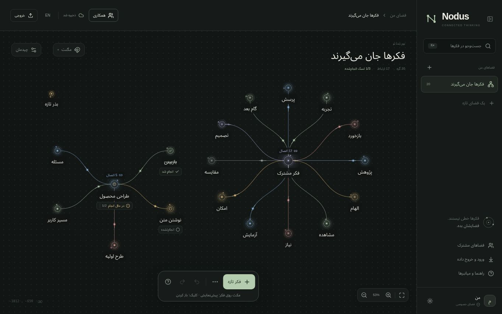
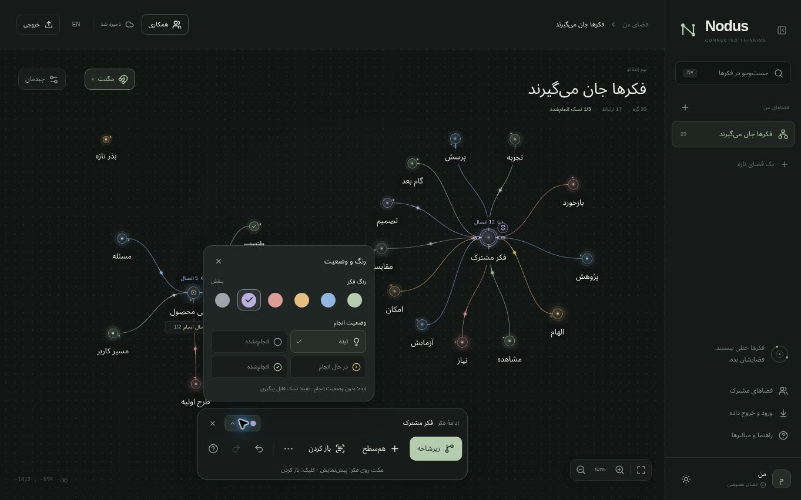
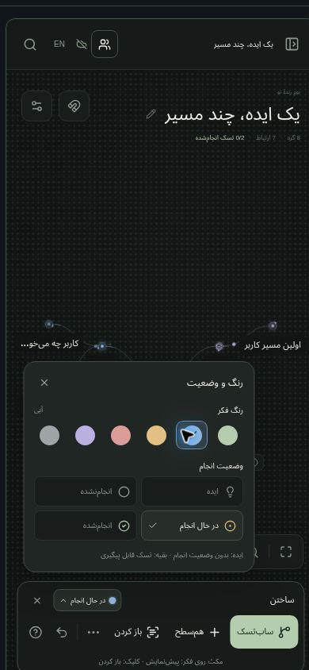

# Connected growth, magnetic physics and node controls

Verification date: 2026-11-12. The managed preview remained on
`http://127.0.0.1:4173/` throughout this work.

## Automated verification

The full test command passed **181 tests**, with zero failures, skips or cancellations:

```bash
node --import ./tests/server-loader.mjs --test tests/*.test.ts tests/*.test.mjs
```

TypeScript checking (`npx tsc --noEmit`) and `git diff --check` also passed.
Growth tests include incoming hubs, duplicate/reverse/task links, cycles,
deletion and restored snapshots. Energy tests verify monotonic bounded values.
The 23 magnetic tests include dense 20/50-branch hubs, mixed card sizes,
pins and held contacts, different step rates, retained momentum, and the
existing 5,000-node spatial-work bounds. These deterministic cases do not
establish a browser frame-rate guarantee for every board.

## Managed browser verification

The real `NodusApp` ran in the isolated clarity and growth fixtures. Their
synthetic revision-checked APIs cannot alter the production workspace.

### Growth and motion

The growth board rendered 20 nodes and 17 edges. DOM attributes and computed
animation styles confirmed the following while no node was hovered:

| Node | Unique neighbors | Outgoing branches | Growth scale | Breathing period | Orbit period |
| --- | ---: | ---: | ---: | ---: | ---: |
| `growth-isolated` | 0 | 0 | 1.000 | 5.600 s | 16.000 s |
| `growth-five` | 5 | 5 | 1.771 | 4.184 s | 11.751 s |
| `growth-twelve` | 12 | 2 | 2.043 | 3.715 s | 10.345 s |

The last node has ten incoming links. Its higher scale and faster activity
therefore demonstrate that receiving connections now contributes to growth.
All three task states were visible, including the parent's 1/2 subtask count.

### Color, status and keyboard scope

- The selected task changed from amber to violet, then from doing to done.
- One Undo returned it to doing while keeping violet. Redo restored done.
- Reload preserved the violet color and done status.
- Delete on a status button created no node deletion or extra thought.
- Escape closed only the quick panel and returned focus to its trigger.
- Tab moved between the panel's native controls without creating a branch.
- In a 390 × 844 frame, the panel measured 292 px wide and stayed within the
  viewport. Document `clientWidth` and `scrollWidth` were both 390 px.
- A mobile color change to blue immediately updated the selected node and
  its trigger. F2/Escape still entered and left inline title editing.

### Magnetic movement

- Start changed the state to running, moved all 20 nodes and reached settled.
- The fixture still reported zero workspace writes after the first burst.
- Pinning `growth-twelve` retained its projected left/top at
  `(426.538, -22.6317)` through a second rebalance and settlement.
- A native pointer drag moved that pinned node to `(523.998, -80.7317)`;
  its pin remained, neighbors moved again and the network settled.
- That deliberate drag produced one workspace write. The animation and
  subsequent simulation did not produce additional document writes.

## Images

These are exact screenshots of the real app running on synthetic test data:







## Boundaries

The production Site required sign-in in this browser, so the UI checks above
used isolated fixtures. They do not establish production sign-in, two real
signed-in accounts, physical touch-device behavior, native Persian IME input
or cross-account attachment access. Reduced-motion and hidden-page handling
were reviewed in code; they were not separately exercised in this pass.
Captured console error entries were browser-extension metadata errors, not
an application failure; a limited log sample is not a full console audit.
