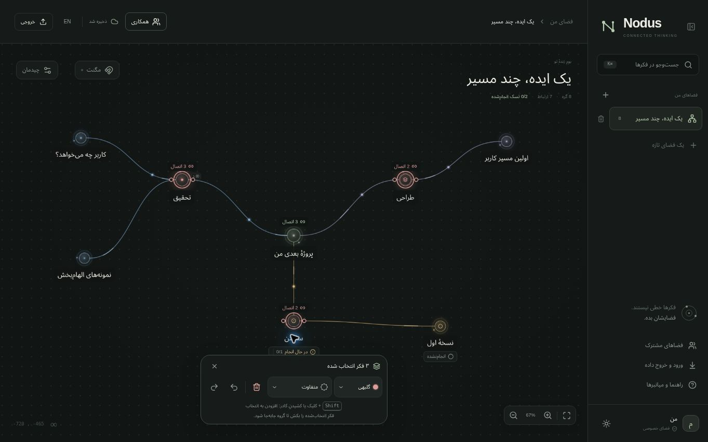
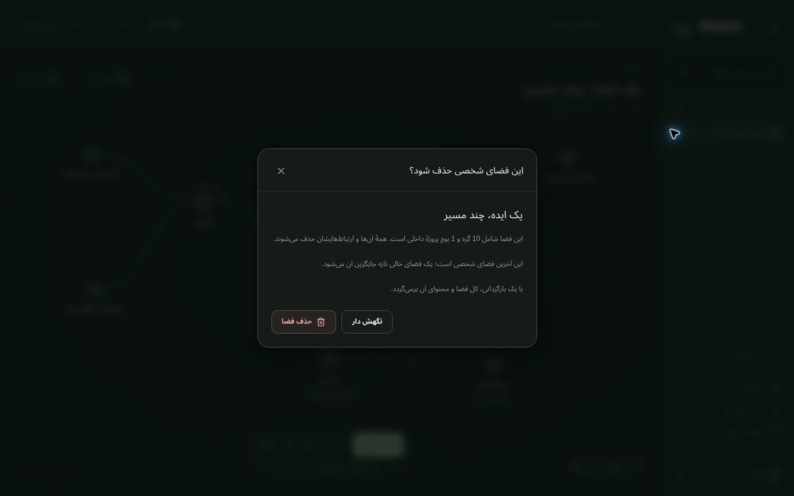
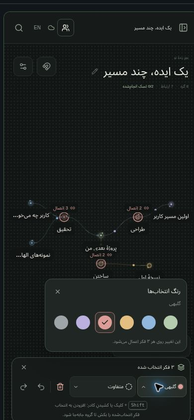

# Multi-selection and personal-space deletion

Verification date: 2026-11-12. The managed preview remained on
`http://127.0.0.1:4173/` throughout this work.

## Environment and automated baseline

The real `NodusApp` ran through `/tests/browser/clarity-fixture` with its
isolated synthetic identity and revision-checked fixture API. The initial
workspace contained eight thoughts on the main board and two thoughts inside
a nested project: ten nodes and eight edges in total.

| Surface | Configuration |
| --- | --- |
| Desktop | Chrome, 1365 × 1024 viewport |
| Mobile layout | 390 × 844 frame inside desktop Chrome |
| Persistence | Isolated synthetic fixture state; no production workspace |
| Automated regression baseline | **205 tests passed** |
| TypeScript | Checking passed |
| Production build | Run separately by the publication workflow |

The automated suites include board-scoped bulk edits/deletion, projected
rectangle selection, task ancestry, root-space deletion, blank-home fallback,
single-step history and large/deep synthetic graphs. The browser observations
below cover the actual application interactions on the fixture.

## Selection, movement and keyboard scope

| Check | Observed result |
| --- | --- |
| Shift+click | Clicking research, design and build selected exactly three thoughts. No content popup opened and the fixture recorded no workspace writes. |
| Toggle membership | Shift+clicking design again reduced the group from three to two; toggling it back restored three. |
| Group drag | A native pointer drag of a selected member moved the pointer by (+60, +40) screen pixels at a displayed 67% zoom. Exactly the selected three nodes moved by (+89.32, +59.55) world units; all five other main-board nodes stayed unchanged. |
| Group move Undo | One native Ctrl+Z restored all three moved nodes to their previous positions. |
| Select all | Ctrl+A with canvas focus selected all eight main-board thoughts and excluded the two thoughts inside the nested project. |
| Clear selection | Escape on the graph reduced the selection count to zero. |
| Additive rectangle | Shift+dragging a rectangle around the left cluster selected research, question and inspiration, without a workspace write. |
| Group context menu | Right-click preserved that three-node selection and exposed the group-delete action. |
| Native title selection | Ctrl+A inside a title textbox selected all five Persian characters. Graph selection stayed at one node. |

The screen and world distances above are measured values; the displayed zoom
is rounded. Group movement was verified by comparing each selected and
unselected node's coordinates before and after the drag.

### Ordinary canvas pan

With no group selected, an unmodified drag on empty canvas moved the pointer
by (+60, +40) screen pixels. The inspected node's DOM rectangle shifted by
exactly (+60, +40), while its saved style coordinates stayed unchanged.
Selection remained empty and the fixture write counter stayed at **11**.
This verified the ordinary pan gesture after the selection changes.

## Bulk appearance, status and deletion

| Check | Observed result |
| --- | --- |
| Bulk color | Choosing rose changed only the selected three thoughts. |
| Delete inside palette | Pressing Delete while focused inside the palette left all eight main-board thoughts intact. |
| Local Escape | Escape closed the palette and returned focus to its trigger. |
| Bulk task state | Choosing Done applied that state to the three selected thoughts. |
| Status Undo | The toolbar's Undo restored the previous mixed task states while retaining the earlier rose color change. |
| Graph Delete | Delete with the research/question/inspiration group selected removed three main-board thoughts. One Undo restored the main-board count to eight. |
| Nested-project confirmation | Deleting a research/design selection displayed a confirmation reporting two selected thoughts plus two internal thoughts. Canceling retained the content. |

These checks distinguished graph shortcuts from native panel/textbox
controls and verified separate history entries for bulk color, bulk status
and group deletion.

## Personal-space deletion and recovery

The sidebar's root-space confirmation displayed **10 nodes**, **1 nested
project canvas**, and the last-personal-space warning. Canceling left the
workspace unchanged.

Confirming the deletion left **zero nodes and zero edges**, with one fresh
blank root. One native Ctrl+Z restored the original **10 nodes and 8 edges**.
Opening the restored nested project's details showed its two internal
thoughts again.

A second test root was then created. While that second root was active,
deleting the original space left the second root as the sole root and kept it
as the current board. Undo restored the original space without removing the
second root.

### Reload

Reload preserved both root spaces, the restored original content of ten nodes
and eight edges, and the rose color changes. The fixture displayed **writes
11 / revision 11** after reload.

This reload check verifies saved document state. Undo uses the current
session's history; the application does not provide persistent trash or a
deleted-space archive. The fixture used no live attachments or R2 objects.

## Mobile layout and selection mode

In the 390 × 844 frame, **More actions → Select multiple thoughts** enabled
selection without Shift. Clicking three thoughts selected a three-node group.

| Element | Measured width | Horizontal bounds |
| --- | ---: | --- |
| Group toolbar | 360 px | x = 15–375 |
| Color palette | 286 px | x = 82–368 |
| Document | 390 px client width | 390 px scroll width |

The measured toolbar and palette stayed inside the frame, and the document
had no horizontal overflow. This was a mobile-sized desktop browser frame;
physical touch hardware was not used in this pass.

## Screenshots

These screenshots show the real application using synthetic fixture data.

## Coverage boundaries

The production tab remained at **Sign in required**. Production authentication
was not retested; the interaction results above concern the isolated real UI
with synthetic persistence. This phase did not run a two-client real-time
collaboration test, a physical touchscreen test, native Persian IME
composition, or cross-account attachment access.

The limited console sample contained ten error entries, all associated with
Chrome-extension metadata. No application-owned error appeared in that sample;
it was not an exhaustive console audit. The publication workflow runs the
production build separately.
